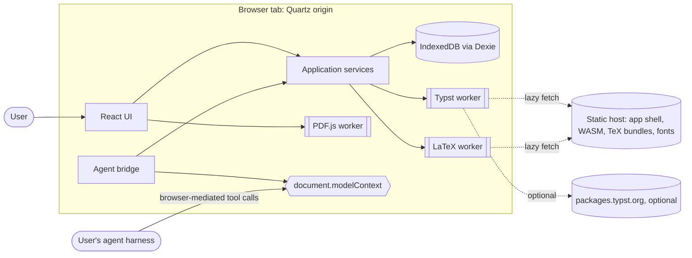

# Architecture Overview

## 1. One-paragraph summary

Quartz is a static React SPA built with Vite. All state lives in IndexedDB (through Dexie). Each compiler engine runs in its own lazily created dedicated Web Worker, talks to the app through Comlink, and receives a snapshot of project files; it returns PDF bytes, logs and normalized diagnostics. PDF.js renders the output. An application service layer (project, file, compile, change-set services) is the only way state changes, whether the caller is a React component, the command palette or an agent. The agent bridge maps a typed tool catalog onto those services and registers it with `document.modelContext` when WebMCP exists. Nothing in Quartz talks to a Quartz-operated server; the only network traffic is static asset loading (app shell, engine WASM, TeX bundles, fonts) and optional user-visible fetches (Typst packages).

## 2. System context



The agent harness is outside Quartz. It reaches the tools through the browser: a browser-integrated agent (Gemini in Chrome, Brave Leo, an extension) or an automation bridge the user runs themselves (Chrome DevTools MCP with its experimental WebMCP category, Playwright's WebMCP API). See [agent-bridge.md](agent-bridge.md).

## 3. Layers and dependency rule

```
apps/web (React, routing, composition root)
   │ depends on
   ▼
feature UI ──► application services (in apps/web/src/services, framework-free TS)
                    │ depend on ports defined in packages
                    ▼
packages: document-core (pure domain) ◄── storage, project-format, compiler-core,
          agent-bridge, editor (CodeMirror, no React)
          compiler-latex / compiler-typst ──► compiler-core
          ui (React components only, no domain)
```

Rules (enforced by package dependencies and Biome `noRestrictedImports`):

1. `document-core` depends on nothing but `zod`.
2. No package except `ui` and `apps/web` imports React.
3. `agent-bridge` depends on `document-core` and an operations port it defines; it never imports storage or compilers directly.
4. Engine packages are imported only through dynamic `import()` from the compile service.
5. `ui` never imports domain packages; it receives data through props.

## 4. Key runtime flows

### Edit and autosave
Editor transaction → `FileService.updateContent(projectId, path, text)` (debounced 750 ms) → Dexie transaction writes `fileContents` + bumps `files.revision` and `projects.updatedAt` → liveQuery notifies other views and tabs.

### Compile
`CompileService.request(projectId)` → queue coalesces (one running, one pending, latest wins) → snapshot files from Dexie → transfer to engine worker → result normalized → PDF bytes stored in memory (and optionally in `artifacts`) → viewer swaps document when ready; on failure keeps last good PDF.

### Agent write
WebMCP `execute` → schema validation (zod) → path validation → `ChangeSetService.stage(...)` → returns `{ changeSetId, status: "pending_review" }` → user approves in the review panel → `FileService` applies atomically → `undo` reverts the change set.

## 5. Where the documents go deeper

| Topic | Document |
|---|---|
| Packages and tooling | [monorepo.md](monorepo.md) |
| State, routing, workers, PWA | [client-side-architecture.md](client-side-architecture.md) |
| IndexedDB schema, autosave, quota | [storage-architecture.md](storage-architecture.md) |
| Engines and workers | [compiler-architecture.md](compiler-architecture.md) |
| WebMCP and review flow | [agent-bridge.md](agent-bridge.md) |
| Threat model | [security.md](security.md) |
| Tests | [testing-strategy.md](testing-strategy.md) |
| Self-critique | [final-review.md](final-review.md) |
