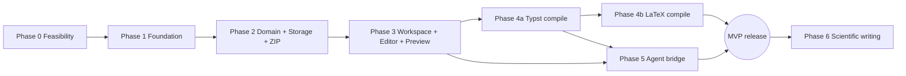

# Implementation Plan

Detailed tasks: [task-backlog.md](task-backlog.md). Acceptance criteria: [acceptance-criteria.md](acceptance-criteria.md). Complexity scale: S (≤ 1 day), M (2-4 days), L (1-2 weeks), XL (> 2 weeks) for one experienced engineer or a supervised coding agent.

## Ordering principles

1. Retire the biggest risks first (LaTeX engine, Typst API, WebMCP harness reality).
2. Reach a thin end-to-end slice early: create project → edit → Typst compile → preview → reload. Typst goes before LaTeX because its integration risk is lower.
3. Each task ends with a verifiable artifact and tests.
4. Agent features build on the same services the UI uses; no parallel code paths.

## Phase 0: Technical feasibility (XL, ~3 weeks, spikes run in parallel)

- **Deliverables**: six spike result files in `docs/technical-spikes/results/`, updated ADR-002..006, OQ-2 decided (OQ-1 already decided: `MIT OR Apache-2.0`), license inventory against that policy.
- **Dependencies**: none. Spikes are independent and can run in parallel sessions; Spike 6 is the smallest.
- **Tasks**: T-0.1.x (LaTeX), T-0.2.x (Typst), T-0.3.x (archive), T-0.4.x (storage), T-0.5.x (WebMCP), T-0.6.x (Smooth UI), T-0.7.1 (license review), T-0.7.2 (go/no-go review).
- **Acceptance**: every spike has a go/no-go verdict against its criteria; ADR-004 names the LaTeX engine.
- **Testing**: spike harnesses are throwaway, but malicious ZIP fixtures, LaTeX/Typst corpora and log fixtures are kept.
- **Risks**: LaTeX no-go (fallbacks in ADR-004); WebMCP harness unavailable (not a blocker).
- **Gate**: no Phase 1 scaffolding before T-0.7.2.

## Phase 1: Project foundation (M)

- **Deliverables**: monorepo skeleton with all packages (empty public APIs), Vite app shell rendering an empty layout, Tailwind 4 + shadcn (Base UI) + selected Smooth UI components in `packages/ui`, Biome, Vitest (node + browser), Playwright smoke test, CI workflow, AGENTS.md updated with real commands, PWA shell.
- **Dependencies**: Phase 0 gate.
- **Tasks**: T-1.1.x workspace, T-1.2.x app shell, T-1.3.x UI package, T-1.4.x tooling and CI, T-1.5.1 PWA.
- **Acceptance**: AC-1.*.
- **Testing**: CI runs lint, typecheck, unit, browser tests, e2e smoke.
- **Risks**: shadcn CLI monorepo alias issues (Spike 6 covers).

## Phase 2: Domain, storage and ZIP (L)

- **Deliverables**: `document-core` (paths, models, engine detection, templates, change-set model), `storage` (Dexie schema v1, repositories, quota helpers), `project-format` (ZIP writer, reader, validation, single-file import), services (`ProjectService`, `FileService`), dashboard UI (list, create, rename, duplicate, delete, import, export).
- **Dependencies**: Phase 1.
- **Acceptance**: AC-2.*.
- **Testing**: unit (paths, archive, detection), browser integration (IndexedDB, roundtrip), e2e (create → reload → export → delete → import).
- **Risks**: Dexie compound-unique behavior; Safari Blob quirks (Spike 4).

## Phase 3: Workspace, editor and preview (L)

- **Deliverables**: workspace layout with resizable/collapsible panels, explorer with CRUD and DnD, CodeMirror tabs with LaTeX and Typst languages, autosave and save status, search/replace, command palette and shortcut registry, PDF.js preview component (loads any PDF bytes), theme switching, workspace state persistence, multi-tab lock.
- **Dependencies**: Phase 2.
- **Acceptance**: AC-3.*.
- **Testing**: component tests for explorer and tabs; e2e for edit → reload restores tabs; PDF viewer integration with a fixture PDF.
- **Risks**: editor performance on large files (> 1 MB); PDF.js worker setup with Vite.

## Phase 4a: Compilation system + Typst (L)

- **Deliverables**: `compiler-core` (contracts, EngineHost, queue, status store), `compiler-typst` adapter + worker, local fonts, `CompileService`, diagnostics in editor and problems panel, log panel, auto-compile, stale handling, PDF download, offline caching of Typst assets.
- **Dependencies**: Phase 3 (preview, editor diagnostics), Spike 2 go.
- **Acceptance**: AC-4.1-4.6.
- **Testing**: queue unit tests; worker integration; Typst corpus nightly.

## Phase 4b: LaTeX (L to XL)

- **Deliverables**: `compiler-latex` adapter for the engine chosen in Spike 1, curated package-set build/publish script (static, target < 500 MB), multi-pass runner (if the engine does not already rerun), BibTeX, `biblatex`-without-`backend=bibtex` detection, log parser with golden tests, cancellation by termination, offline readiness panel, third-party notices.
- **Dependencies**: Phase 4a (core), Spike 1 go, OQ-2.
- **Acceptance**: AC-4.7-4.12.
- **Testing**: LaTeX corpus nightly; log-parser golden files; e2e LaTeX flow.
- **Risks**: package coverage, mirror hosting, memory.

## Phase 5: Agent bridge (L)

- **Deliverables**: `agent-bridge` catalog (v1 tools), ToolRuntime with policy, limits and activity events, `ChangeSetService` (stage, apply, reject, conflict, undo), review UI (cards + full merge view + inline editor decorations), activity panel (Smooth UI), WebMCP adapter with feature detection and OT token, "Connect your agent" guide in-app and in docs.
- **Dependencies**: Phase 3 (editor, services), Phase 4a (compile tools); LaTeX not required.
- **Acceptance**: AC-5.*.
- **Testing**: unit (schemas, policy, change sets), polyfill integration in all browsers, optional native Chromium job, e2e agent flow.
- **Risks**: WebMCP churn; harness behavior.

## MVP release checklist

All AC through Phase 5 pass; E2E workflow passes on Chromium, Firefox, WebKit; security checklist reviewed; THIRD_PARTY_NOTICES generated; storage warning UX present; CSP active.

## Phase 6: Advanced scientific writing (post-MVP, XL overall)

Order by value/effort:
1. Bibliography: `.bib` parser, citation completion with previews, undefined/unused citation detection, `ai-citation`-style hover cards (M).
2. Cross-references: label index, go-to-definition, find usages, broken reference detection (M).
3. SyncTeX for LaTeX (engine-dependent) and Typst source mapping: click PDF → source, source → PDF highlight (L).
4. Document history: periodic snapshots for manual edits with diff and restore (M).
5. File System Access: open/export local folders in Chromium (M).
6. Optional integrations: Crossref/OpenAlex lookup by DOI (user-initiated fetch), Zotero (local connector / Better BibTeX export file import) (M each).
7. Additional exports: Typst HTML export, LaTeX → HTML via LaTeXML (if engine supports) (L).
8. Collaboration: Yjs + y-codemirror.next over WebRTC (no server is hard: needs signaling; re-evaluate the constraint first) (XL).

## Internationalization (planned)

Quartz ships English text only. Settings already stores a language preference (`system` or `en`, see `apps/web/src/app/locale.ts`), so adding languages changes no stored data.

1. Move interface strings into typed message catalogs, one per locale, with English as the source and the fallback. Includes service error messages, which should become codes plus parameters.
2. Format numbers, dates and plurals with `Intl` instead of hand-built strings.
3. Resolve `system` from `navigator.languages`; set `<html lang>` accordingly.
4. Add locales (Portuguese first), loading each catalog on demand, and check layouts with longer text.

Choose the library, if any, when the work starts; it must be permissive, small and need no runtime network access. Document content is never translated.

